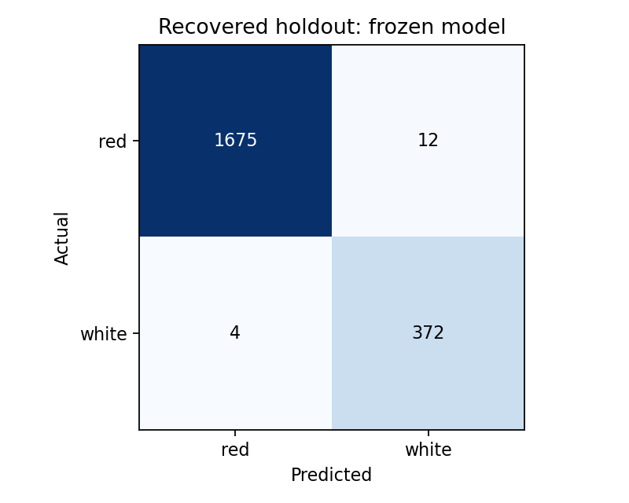
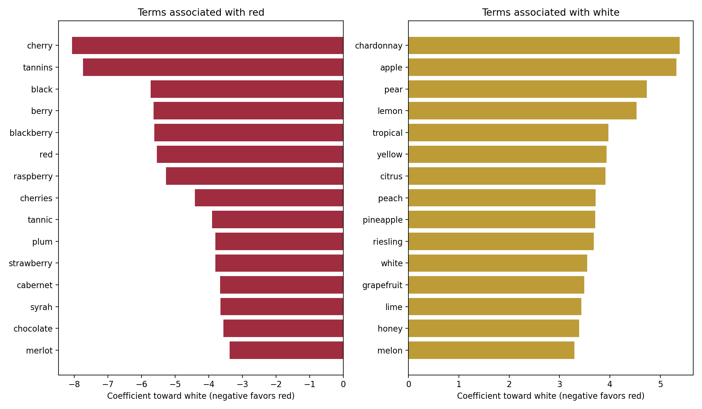
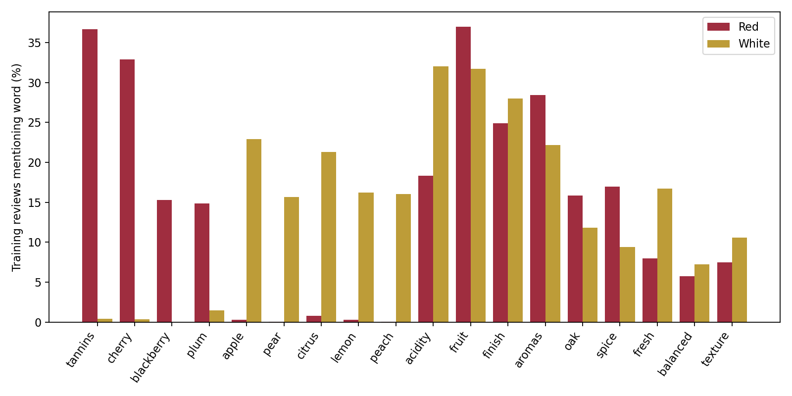
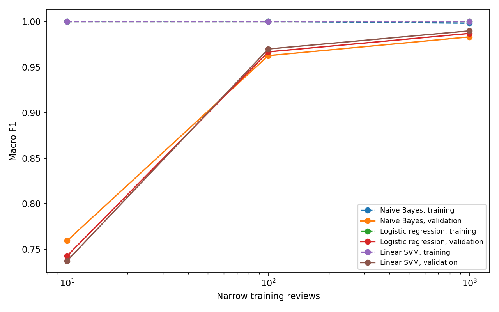

# Team Bordeaux: completed analysis, steps 1–5

This handoff completes auditing, language interpretation, model selection, and a
single locked final evaluation. It is supporting analysis for the team's final
presentation/report, rather than the final course report or slide deck.

## Selected model and evaluation

The selected model is **Linear SVM**, trained on
**81,141** audited all-region reviews (`allregion_full`).
It uses description-only unigram/bigram TF-IDF, `min_df=2`, 10,000 maximum features,
sublinear term frequency, and `C=1`. Features are fitted on training rows only.
Selection used the highest validation macro F1 among six all-region candidates
(three classifiers at 20,000 and full training size), with accuracy as tie-breaker.
The majority dummy is a reference, not a selection candidate.

| Population | Reviews | Accuracy | Macro F1 |
| --- | ---: | ---: | ---: |
| Selected model training | 81,141 | 99.8965% | 0.9988 |
| Development validation | 27,121 | 99.0598% | 0.9893 |
| Recovered final holdout | 2,063 | 99.2244% | 0.9871 |

Final accuracy's conditional 95% bootstrap interval is
**98.84%–99.56%**; macro F1's is
**0.9804–0.9929**.
Holdout class counts: {'red': 1687, 'white': 376}. Confidence intervals resample review
outcomes with the trained model fixed; they do not include uncertainty in label
rules, model selection, training, or correlation among related wines.



The frozen pipeline is `selected_pipeline.joblib`; the exact selection, training
IDs, validation IDs, dependency versions, policy, and SHA-256 checks are in
`selection_lock.json`. The evaluation function writes a start marker and refuses
to evaluate again. Reading saved predictions or this notebook does not rerun it.

## 1. Historical exposure and holdout recovery

The audit inventories **25 distinct historical
notebook code versions** from Git history. It reconstructs the original Models
1–2 samples and the executed EDA notebook's separate 80/10/10 split, in addition
to the current saved split. The EDA experiment used 20,243 current saved-test rows
for training and 5,683 for validation. The original Models 1–2 additionally
intersect current test rows; overlapping counts must not be added as if disjoint.

Of the saved test's 31,615 red/white rows, **5,679** have no recovered predictive
training/validation text exposure. Excluding wine families appearing in any
reconstructed exposed population leaves **2,517** candidates. The family proxy is
the tuple (winery, variety, province, region_1, designation), with missing fields
normalized to empty strings. It intentionally groups vintages and can also merge
different wines; it is not a definitive bottle identifier.

The frozen label rules exclude **454** of these
candidates. The remaining **2,063** were evaluated once, after model
selection. Every original row has flags in `exposure_manifest.csv`; final label
exclusions are in `final_holdout_label_flags.csv`.

**This is a recovered predictive holdout, not a pristine external test set.**
Whole-data EDA and the earlier descriptive word heatmap included aggregate
information about it. Uncommitted/deleted experiments or runs on other computers
cannot be reconstructed. Family and label exclusions also change the population.
Future independent reviews would provide stronger confirmation.

## 2. Label audit

The fixed mapping covers 45 common varieties or explicitly color-named blends.
The retained development subset contains 108,264 red/white rows before normalized
duplicate removal. Explicit rosé, sparkling, dessert/fortified, and orange styles
are excluded; original data and labels are preserved. No test-row label changes
were made. The same policy is applied to each partition independently.

Read [LABEL_AUDIT.md](LABEL_AUDIT.md) for confirmed conflicts, inspected examples,
known false positives, and remaining uncertainty. Counts by country and variety
are in `country_coverage.csv` and `variety_coverage.csv`. Coverage is broad but the
subset is not representative of all varieties or the world wine market.

## 3. Differences and similarities in language

The selected linear classifier's strongest associations include:

- Red: cherry, tannins, black, berry, blackberry, red, raspberry, cherries, tannic, plum.
- White: chardonnay, apple, pear, lemon, tropical, yellow, citrus, peach, pineapple, riesling.

Negative coefficients favor red and positive coefficients favor white; class
order was checked explicitly. Coefficients describe conditional predictive
associations, not causal sensory effects. Correlated words and varietal names can
share or substitute for one another. Magnitudes depend on the TF-IDF transform.



Training-document frequencies supply a separate descriptive check. Words are
counted once per review. Among the predefined sensory vocabulary, words present
in at least 10% of both classes and differing by at most 10 percentage points are:

| term | red_pct | white_pct |
| --- | --- | --- |
| fruit | 37.0 | 31.73 |
| finish | 24.87 | 28.01 |
| aromas | 28.46 | 22.16 |
| oak | 15.87 | 11.81 |

Corpus-wide shared vocabulary also includes
wine, flavors, fruit, finish, palate, aromas, ripe, drink, acidity, rich. `shared_language_training.csv` requires at least
10% prevalence in each color and a prevalence ratio from 0.5 to 2; shared does
not imply identical usage. These summaries use selected-model training data,
not final holdout descriptions.



The masking sensitivity experiment retrained the same selected classifier after
removing mapped grape/color names, aliases, and compound-name components from
training and validation text. Validation accuracy changed from
**99.0598%** to **98.5436%**,
and macro F1 from **0.9893** to
**0.9834**. This measures robustness to explicit clues;
the broad mask can remove ordinary words and cannot isolate a causal contribution.
The mask was not used to select or modify the final model.

`validation_errors.csv` and `validation_error_examples.csv` preserve development
errors with original text, metadata, predictions, and signed decision margins.
High-confidence mistakes are useful for finding residual proxy-label problems;
low-confidence cases can contain overlapping sensory language. An error alone
does not establish which label is correct.

The [validation error review](VALIDATION_ERROR_REVIEW.md) documents apparent
source-label errors, a white Pinot Noir, a missed Vin Gris style, and genuine
sensory overlap. The rules do not perfectly establish finished bottle colors:
**all reported scores measure agreement with the retained proxy labels**. These
findings were documented without changing the frozen model or final holdout.

## 4. Model selection and geographic generalization

All audited all-region selection candidates use the same 27,121 validation rows:

| stage | model | accuracy | balanced_accuracy | macro_f1 |
| --- | --- | --- | --- | --- |
| allregion_20000 | Majority baseline | 0.6741 | 0.5 | 0.4026 |
| allregion_20000 | Naive Bayes | 0.9846 | 0.9796 | 0.9824 |
| allregion_20000 | Logistic regression | 0.9863 | 0.9817 | 0.9843 |
| allregion_20000 | Linear SVM | 0.9888 | 0.9865 | 0.9873 |
| allregion_full | Majority baseline | 0.6741 | 0.5 | 0.4026 |
| allregion_full | Naive Bayes | 0.9864 | 0.9821 | 0.9845 |
| allregion_full | Logistic regression | 0.99 | 0.9869 | 0.9886 |
| allregion_full | Linear SVM | 0.9906 | 0.9886 | 0.9893 |

The matched 20,000-review stages both use 13,000 red and 7,000 white training
reviews and the same validation rows. Their separate geographic scores are:

| stage | group | rows | accuracy | macro_f1 |
| --- | --- | --- | --- | --- |
| california_20000_global | California | 8742 | 0.9928 | 0.9909 |
| california_20000_global | Outside California | 18379 | 0.9678 | 0.9643 |
| allregion_20000 | California | 8742 | 0.992 | 0.9899 |
| allregion_20000 | Outside California | 18379 | 0.9873 | 0.9861 |
| allregion_full | California | 8742 | 0.9925 | 0.9905 |
| allregion_full | Outside California | 18379 | 0.9897 | 0.9887 |

"Outside California" includes records whose province is not recorded as
California; it is a complement of that metadata field, not an independent
geographic verification. Changes in geographic/varietal coverage can improve
transfer beyond California. This comparison alone does not isolate geography
from reviewer, varietal, or other composition changes and does not establish
causation.

The narrow 10/100/1,000 training samples are nested; the California 1,000/10,000/
20,000 stages are also nested. Within those sequences, shrinking training–
validation gaps are consistent with reduced variance. A positive gap alone is
not proof of problematic overfitting. Low training and validation performance
would instead suggest underfitting. Scope changes are reported separately from
training-size changes, and all stage metrics are in `audited_model_comparison.csv`.



The final section of the original full-size notebook was also reproduced on its
original red/white population, with the same TF-IDF and classifier settings.
Those results remain separate because they use different label eligibility:

| model | rows | accuracy | balanced_accuracy | macro_f1 |
| --- | --- | --- | --- | --- |
| Naive Bayes | 31614 | 0.9822 | 0.9792 | 0.9802 |
| Logistic regression | 31614 | 0.9863 | 0.984 | 0.9848 |
| Linear SVM | 31614 | 0.9873 | 0.9859 | 0.9859 |

Existing DistilBERT archives were checked against their row-level predictions,
source labels, and training/validation fingerprints. Scores are in
`verified_original_distilbert_scores.csv`. They use the original population and
are contextual comparisons, not contestants in the audited model selection.
The ZIPs do not include model weights, so a checkpoint cannot be recovered from
the predictions alone. The final selected model is a fully saved TF-IDF pipeline.

## 5. Final evaluation and reproducibility

`final_metrics.json`, `final_classification_report.csv`,
`final_confusion_matrix.csv`, `final_regional_metrics.csv`, and
`final_holdout_predictions.csv` contain the final evaluation outputs. There was
no refitting, tuning, or model switching after opening this holdout for scoring.

Use Python 3.12 with `requirements-analysis.txt`. The run used
`/opt/anaconda3/bin/python` because the default Homebrew Python lacks the required
packages. From the project directory, the first-run sequence is:

```sh
python -m unittest test_bordeaux_analysis.py
python bordeaux_analysis.py audit
python bordeaux_analysis.py develop
python bordeaux_analysis.py evaluate
python summarize_bordeaux_analysis.py
```

The saved run is intentionally locked. Do not delete its lock/start marker to
rerun or improve the reported score. To reproduce development experiments, copy
the source and original input Parquet files to a separate directory without the
saved output folder. Any repeated holdout scoring is reproduction, not a new
independent test. The results notebook reads saved artifacts only.

Original notebooks, original Parquet files, and historical summary CSV are
preserved. The pre-existing user edit in `modeling_2.ipynb` was not changed.
Final slides, the course report, and personal reflections remain separate work.
